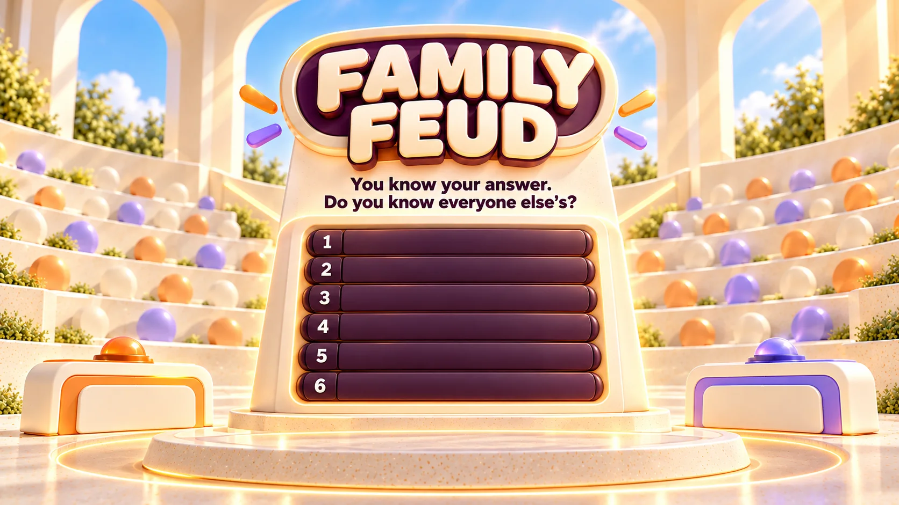

# Family Feud



A complete shared-screen, three-round game. All Family Feud code lives here;
navigation and the session panel are provided by the existing shared Arcade/Atlas owners.

## Play locally

From the Atlas repository root:

```sh
node arcade/family-feud/dev/serve.mjs
```

Open `http://127.0.0.1:4177/arcade/family-feud/`. No build or production dependency install is required.
The server is a loopback-only development utility, not deployment infrastructure.
Finish returns to Arcade. Session names are captured on Start Match; the bridge's
named learner is Player 2, with Player 1/Player 2 fallbacks. The learner opens Round 1; later rounds start with the trailing player (or alternate when tied). No extra name setup.

## Content and matching

The first twenty curated content batches contain **one hundred real six-answer US Season 26
survey boards**: archived survey numbers 19, 85, 111, 121, 137, 3, 61, 117, 136, 151,
35, 50, 54, 92, 104, 21, 107, 135, 144, 153, 8, 12, 72, 147, 159, 40, 82, 118,
130, 152, 26, 36, 64, 91, 141, 39, 58, 62, 74, 109, 6, 70, 131, 139, 143, 29, 60, 89, 128, 145, 27, 57, 67, 99, 129, 14, 31, 48, 76, 98, 24, 41, 79, 90, 155, 4, 9, 18, 77, 134, 10, 114, 115, 140, 161, 33, 51, 94, 97, 123, 13, 44, 88, 95, 158, 7, 28, 38, 47, 81, 46, 56, 66, 100, 160, 1, 59, 110, 119 and 154. Original
question wording, six ranked answer labels and point values are preserved in
`content.mjs`. Their source is the
[Season 26 six-answer archive](https://mstiescott.neocities.org/feud26_6).
Atlas did **not** conduct these surveys. They are archive transcriptions, not
Atlas respondent data.

The repository-only research collection
`dev/season26-six-answer-raw.json` currently contains 161 six-answer survey
records. It is excluded from the deployed static site by the
`arcade/family-feud/dev/` rule in the root `.assetsignore` file. This raw source is separate from the
playable, hand-curated `boards` collection in `content.mjs`. Expand the
playable library only after screening a question for plausible successful guesses,
verifying its source numbers and writing and testing its answer codebook.
This is an editorial selection judgement, not a measured learner success rate.

## Season 25 source archive and Batch 21

The separate research file `dev/season25-six-answer-raw.json` contains
**162 original six-answer Season 25 records** from
[the Season 25 archive](https://mstiescott.neocities.org/feud25_6).
Its internal IDs **162–323** continue after Season 26's **1–161**, making
them unique across both archives. These are **Atlas research identifiers**,
not the website's own season numbering. Each Season 25 playable board also
records `sourceSeason: 25` and its archive position as `sourceOrdinal`.

The raw Season 25 file stays under `dev/`, excluded from the published
site. One source inconsistency is deliberately preserved: Season 25 ID
**306** prints `total_points: 70` even though its six original response
points add up to **80**. The original archive also prints 70; do not
silently adjust the survey or its answers to fix that discrepancy.

**Batch 21** adds five individually screened, genuinely sourced boards
in `content-season25.mjs`, each with a locally authored answer-recognition
codebook: runaway dog (#183), Bigfoot's camping complaints (#187), a
friend evading the restaurant bill (#188), modern Little Red Riding Hood
(#252), and a clown wedding (#282). The five retain their original question
wording, all six labels, rankings and scores. Each round accurately shows
whether its source is Season 25 or Season 26. New survey IDs are not
automatically playable just because they are in either JSON archive.

This season-specific file lives with Family Feud rather than a shared game
system: it owns a distinct, durable season's authored surveys without
moving or rewriting the existing 100 Season 26 boards in `content.mjs`.
The original 40 held Season 26 boards remain held.

The seven former **illustrative development boards** remain under
`legacyBoards` exclusively to restore previously saved matches. New matches
never select them. Their illustrative provenance remains visible if an old
match is resumed.

Matching remains local: normalized aliases, conservative edit distance, then
bounded authored paraphrase/framing rules against the six concepts. Each
source answer has Atlas-authored accepted expressions, a meaning boundary and
explicitly excluded near neighbours. Recognition changes **do not** alter the
original display label or score. It does not call an LLM or guess loosely
associated meanings. Multi-answer ambiguity, duplicates and technical errors
have separate outcomes; errors preserve the exact entry and turn for retry.
Add new natural paraphrases on the basis of manual playtesting.

Replay prefers unseen approved boards and clearly discloses reuse when the
65-board playable pool is exhausted.
## Verification

```sh
node --test arcade/family-feud/dev/rules.test.mjs arcade/family-feud/dev/continuity.test.mjs
node arcade/family-feud/dev/browser-check.cjs
```

Browser checks require Playwright and Chromium. Set `FF_PLAYWRIGHT` to an installed
Playwright module path if it is not on Node's module path, and optionally
`FF_BROWSER` to an installed Chromium executable. Run the local server first.
Screenshots are written to `dev/evidence/` (ignored).

The focused checks cover sourced data fidelity, curated alias and exclusion
matching, saved legacy-board restoration, save/restore, refresh,
learner-session switching,
all three rounds, completion and replay as well as authored aliases, paraphrases,
typos, unrelated neighbours, concept collisions, elimination and solo continuation,
starter rules, scoring, all-found and missed-board endings, complete three-round
play, replay, win/draw, Finish, and an injected one-shot resolver failure/retry.
Browser inspection covers 1280×720 and 1024×768, muted and reduced-motion operation.
The game has no debug controls, answer reveal shortcuts, or hidden text in shutter DOM.

## Classroom-default editorial gate

**One approved board pool; no visible categories or maturity setting.**
`editorial.mjs` owns explicit approval IDs and hold reasons; new surveys
are not playable until approved. Original survey questions, six ranked
answers and points are never edited to make content qualify.

Review the question and **all six answers**, including point distribution:

1. **Tutor comfort:** would this be natural in a first lesson with an unknown,
   potentially younger learner? Hold genuinely intrusive, distressing, demeaning
   or adult material. Harmless romance, body humour, mild slang and fantasy
   scenarios do not automatically disqualify a board.
2. **International access:** enough meaningful guesses should be accessible
   without niche American cultural knowledge. A few obscure US answers are
   acceptable; a question needing a specialised reference to make sense is not.
3. **Entertainment:** imagination, humour, observation or a genuine surprise,
   rather than a merely harmless but boring question.
4. **Guessability:** six meaningfully distinct answers and several plausible
   scoring opportunities. Obscure lower answers are fine; opaque main answers
   or wildly unconstrained questions are not.
5. **Conversation:** playful reasoning, vocabulary and comparisons without
   demanding a personal disclosure or inviting targeted insults.

Apply proportional whole-board judgement, not an isolated-word blacklist.
Even one significantly uncomfortable revealed answer may justify a hold.

The first screen approved 30 and held 70 boards. A complete second review
reinstated **31**, initially leaving **61 approved** and **39 held**.
A follow-up review held survey #6 (Sleeping Beauty) again: although the six
answers are innocent bedtime habits, the question's bedroom innuendo could be
awkward in a first lesson. Survey #117 (castle) remains approved: its dungeon
answer is non-graphic historical fantasy. **Now 60 approved and 40 held.**
The famous-captains board passes despite two regional references. Cinderella
stays held because an underwear answer ranks second. The complete review
is recorded by source ID in `editorial.mjs`.

After Batch 21, **65** sourced boards are approved and playable, while the
original **40 held** Season 26 surveys remain unavailable in new matches.

All 100 Season 26 surveys remain unchanged. The review is provisional editorial
judgement, not measured tutor/learner playtest evidence. Replacements from
other seasons need the same approval. Our goal remains 100 **approved** boards.
Old snapshots containing a held survey cannot be resumed; approved-sourced and
legacy illustrative matches remain restorable. No new UI or shared system.

## Atlas Continue

Starting a match creates a versioned Family Feud snapshot under the active Atlas
learner session in the existing AtlasBridge registry. An untouched opening board
is saved but reports zero progress: the Arcade and Atlas Continue surfaces become
eligible only after the first valid guess or pass. The snapshot preserves board
IDs, round, current contestant, starting
contestant, scores, round contributions, strikes, revealed answers and contestant
names. Answers, passes, board reveals and round transitions checkpoint the match.
Reopening the page (including through Atlas Continue) shows the cover first.
**Continue Match** then restores the exact unfinished playing, missed-board or
round-end state without creating a new match, resetting scores or opening a round.

Changing the active Atlas learner session loads that learner's own match (or the
start screen when none exists); pending answer animations cannot apply results
across learner sessions. The final result marks the match complete, clears the
resumable snapshot and removes Continue eligibility. Recent Activity remains, and
Play Again starts a fresh three-round match. During an unfinished match, the
muted **New Match** game-header control opens a confirmation dialog. Confirming
starts a new three-round match for the selected learner only, replacing their
unfinished snapshot and resetting current scores and reveals without clearing
the browser's previously seen boards or another learner's match. Cancelling
leaves gameplay untouched. Pending animations cannot apply old-match results
after confirmation or cross-session switching. This uses AtlasBridge's existing
browser-local continuity, not cross-device or server-side game storage.

The cover features a clickable Season 26 authenticity plaque above the six
answer shutters. Its native popover explains the use of genuine TV questions,
rankings and points, and naturally phrased guesses. It is hidden during play.

Previously seen board IDs continue to be stored in browser-local storage to
prefer fresh boards in later matches. Sound starts off and can be enabled with
the top-right control. Keyboard Enter submits; all other actions use standard
focusable buttons. No human judging role.
