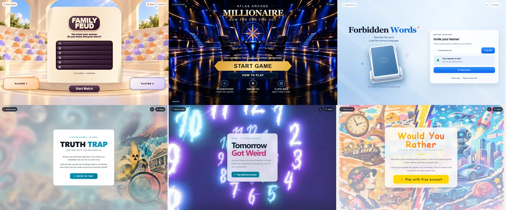
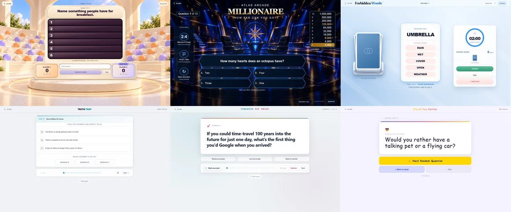
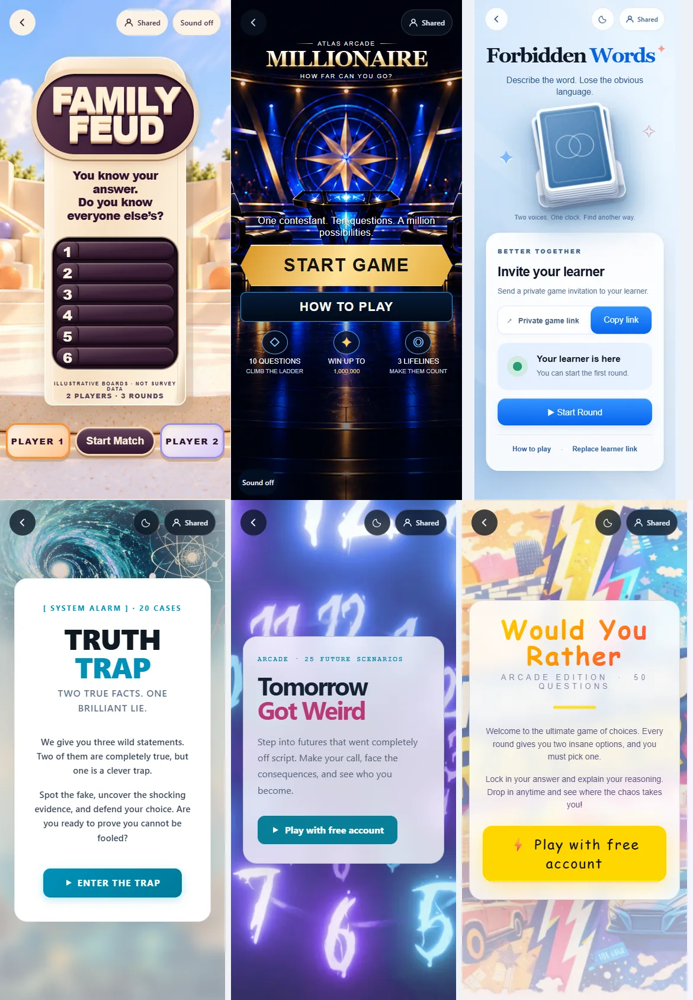
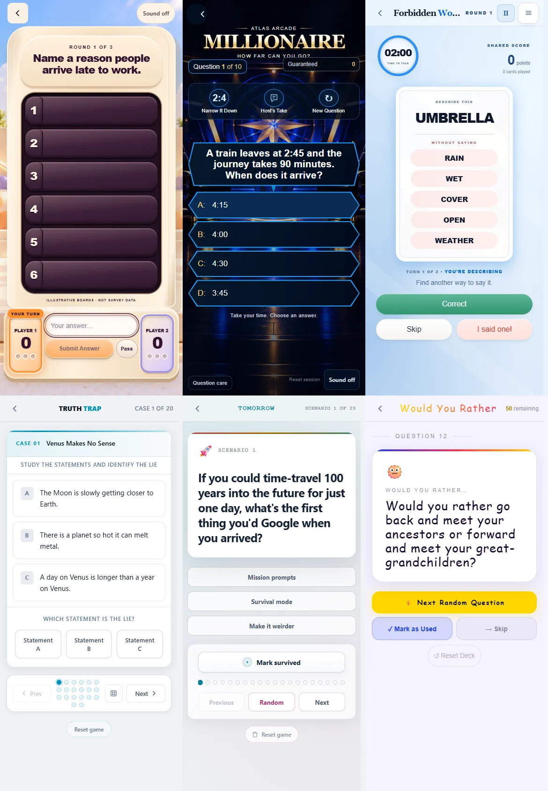
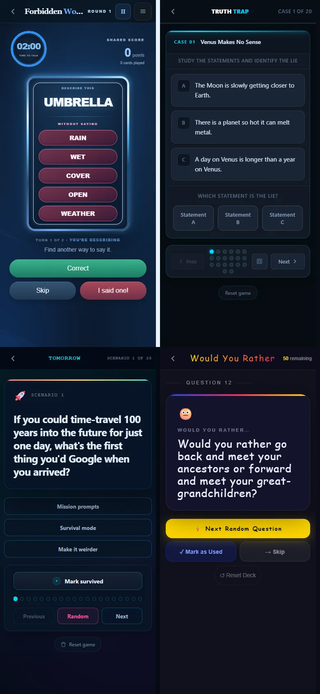

# Arcade chrome and sound verification

Verified on 2026-10-22 in Chromium (installed Google Chrome, headless), using the actual local HTML, scripts and artwork.

## Changes

- Shared cover controls use consistent type, 16px icons, 38px desktop controls, 44px mobile targets, readable surfaces and visible focus rings. Game palettes remain local overrides.
- Family Feud places Session and Sound in the same cover utility row. Its single Sound button moves to the gameplay header. Hidden gameplay chrome cannot intercept cover clicks.
- Narrow three-zone headers reserve room for navigation and progress, truncating identity text before it overlaps. Family Feud fits 320px; Millionaire's cover title clears long session controls.
- Family Feud, Millionaire and Forbidden Words expose a stable `Sound` toggle name with `aria-pressed=true` meaning enabled, visible on/off text and an action tooltip. All default off and save subsequent choices per game. Existing Forbidden Words preferences are retained.
- Millionaire keeps sound in its bottom utility area. Forbidden Words keeps it in the gameplay header, including its existing mobile disclosure. Native button semantics and focus return work in that disclosure; polling preserves Sound focus.
- Restored Forbidden Words sound unlocks on the next user action. Storage or audio failures do not prevent the toggle from updating.

No artwork, question content, scoring or gameplay rules changed. The two fixed-theme games remain fixed-theme; no sound was added to Truth Trap, Tomorrow Got Weird or Would You Rather.

## Browser checks

All six games passed at **1440×900, 390×844 and 320×844**:

- Cover and active gameplay screenshots; horizontal overflow checks.
- Session control opens, long session labels fit, and navigation does not overlap Session.
- Supported light/night controls switch appearance; light/night gameplay screenshots inspected.
- Sound defaults off, toggles by Enter/Space, survives reload in both states, and works when storage throws.
- Additional audio checks at desktop/390px: no AudioContext while initially off; enabling creates audio; Forbidden Words restores audio on interaction after reload and retains keyboard focus across polling.
- The mobile disclosure closes with Escape. Fixed-theme and sound-free game contracts remain intact.

The browser script serves repository files via Playwright routes. Forbidden Words uses its existing local-verification entry with deterministic API responses; Tomorrow Got Weird and Would You Rather use their existing local entry hook. Production authentication and live multiplayer networking were not exercised. External resources are blocked, so screenshots also exercise fallback fonts. Audio initialization was asserted; speaker output was not subjectively assessed.

Run with Playwright on the Node module path and a Chromium executable:

```powershell
$env:NODE_PATH = '<directory containing playwright>'
$env:CHROME_PATH = '<path to chrome.exe>'
$env:ARCADE_SCREENSHOTS = '<output directory>'
node scripts/verify-arcade-chrome.cjs
```

Optional `ARCADE_GAMES` and `ARCADE_WIDTHS` accept comma-separated subsets.

## Automated results

| Check | Result |
| --- | --- |
| Family Feud rules, continuity and sound persistence; Millionaire engine and continuity | 21/21 passed |
| Shared chrome/mobile contract | Passed |
| Anonymous Arcade access contract | Passed |
| Chromium six-game viewport matrix | 18/18 passed, plus all three blocked-storage cases |
| Additional sound/audio/focus checks | Passed at desktop and mobile |
| Full root suite with CRLF normalized in memory | 91/91 test files passed |
| Unmodified full root command on this Windows checkout | 78/91; identical 13 failures reproduced from untouched base `62a2eef` |
| JavaScript syntax and `git diff --check` | Passed |

The 13 baseline failures use newline-sensitive source-string checks. A temporary Node preload wrapped `fs.readFileSync` to replace `\r\n` with `\n` in returned strings, without changing repository files, assertions or runtime behavior. With that input normalization, all 91 files pass. The updated Forbidden Words assertion recognizes the added shared utility class and pressed-state contract.

## Reviewed screenshots

For the six-game sheets, read left to right: **Family Feud, Millionaire, Forbidden Words**, then **Truth Trap, Tomorrow Got Weird, Would You Rather**.

### Desktop covers



### Desktop gameplay



### Mobile covers



### Mobile gameplay



### Supported night themes

Forbidden Words, Truth Trap, Tomorrow Got Weird, Would You Rather:


